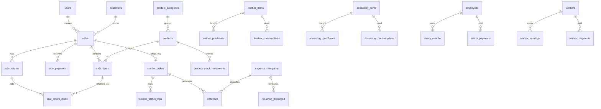

# Tasa POS — Database Architecture

| | |
|---|---|
| **Document** | Database Schema (MySQL 8) |
| **Version** | 1.0 |
| **Date** | 11 October 2026 |
| **Follows** | `Tasa-POS-PRD.md` v1.0 — sections are referenced as **PRD §x**, never duplicated |
| **Precedes** | Implementation Prompts |
| **Stack** | Laravel (latest, Starter Kit) · Vue 3 · Inertia · MySQL 8.0.16+ (needed for `CHECK` constraints and generated columns) |

---

## 1. Conventions

| Topic | Rule |
|---|---|
| Engine / charset | InnoDB, `utf8mb4`, `utf8mb4_unicode_ci` (Bangla names and addresses must work) |
| Primary keys | `BIGINT UNSIGNED AUTO_INCREMENT` (`$table->id()`) |
| Foreign keys | `BIGINT UNSIGNED`, real FK constraints. `ON DELETE RESTRICT` by default; `SET NULL` only where stated |
| Money | `DECIMAL(12,2)`, BDT, never `FLOAT` (PRD BR-1, BR-11) |
| Leather quantity | `DECIMAL(12,3)` in sq ft (PRD BR-11) |
| Other quantities | Products and sale lines are whole pieces → `INT`. Accessories use `DECIMAL(12,3)` because units vary (meter, kg, pcs) |
| Dates | Business dates as `DATE`; event times as `DATETIME`; timezone `Asia/Dhaka` in `config/app.php`, stored as-is (no UTC conversion) so reports group by the shop's calendar day |
| Timestamps | `created_at`, `updated_at` on every table unless stated |
| Soft deletes | `deleted_at` on **master data only** (products, items, customers, employees, workers, users). **Never** on `sales`, payments, ledgers or audit logs (PRD BR-4) |
| Audit columns | `created_by`, `updated_by` → `users.id` (nullable, `SET NULL`) on transactional tables |
| Enums | Use `VARCHAR` + `CHECK ... IN (...)` (Laravel `enum()` is acceptable, but values listed here are canonical) |
| Stored totals | Only where a fast filter is needed. Reports **recompute from source rows** (PRD §11.5). Every stored total has a verification query in §9 |
| Concurrency | Stock and invoice-number writes happen inside `DB::transaction()` with `lockForUpdate()` |

---

## 2. Entity Relationship Overview



---

## 3. Table Groups and Migration Order

Run migrations in this order so foreign keys resolve.

| # | Group | Tables |
|---|---|---|
| 1 | Auth & access (PRD §12) | `users` *(Starter Kit, extended)*, `roles`, `permissions`, `model_has_roles`, `model_has_permissions`, `role_has_permissions` *(spatie/laravel-permission)* |
| 2 | System | `settings`, `audit_logs`, `import_logs`, `invoice_sequences` |
| 3 | Customers (PRD §6.4) | `customers` |
| 4 | Products (PRD §8.1) | `product_categories`, `products`, `product_stock_movements` |
| 5 | Leather (PRD §8.2) | `leather_items`, `leather_purchases`, `leather_consumptions` |
| 6 | Accessories (PRD §8.3) | `accessory_items`, `accessory_purchases`, `accessory_consumptions` |
| 7 | Adjustments (PRD §8.4) | `stock_adjustments` |
| 8 | Expense categories (PRD §9) | `expense_categories`, `recurring_expenses` |
| 9 | Sales (PRD §6) | `sales`, `sale_items`, `sale_payments`, `sale_returns`, `sale_return_items` |
| 10 | Courier (PRD §7) | `courier_orders`, `courier_status_logs` |
| 11 | Expenses | `expenses` *(after `sales` and `courier_orders` because it references them)* |
| 12 | Payroll (PRD §10) | `employees`, `salary_months`, `salary_payments`, `workers`, `worker_earnings`, `worker_payments` |
| 13 | Framework | `jobs`, `failed_jobs`, `job_batches`, `cache`, `cache_locks`, `sessions` *(Laravel defaults)* |
| 14 | Package | Pathao package table (see §4.12) |

---

## 4. Table Definitions

Legend: **PK** primary key · **FK** foreign key · **UQ** unique · **IDX** index · `NN` = NOT NULL.

### 4.1 Auth and access

#### `users` (Starter Kit table + additions)
| Column | Type | Notes |
|---|---|---|
| id | BIGINT UNSIGNED | PK |
| name | VARCHAR(120) NN | |
| email | VARCHAR(190) NN | UQ |
| phone | VARCHAR(20) NULL | |
| email_verified_at | TIMESTAMP NULL | Starter Kit |
| password | VARCHAR(255) NN | hashed |
| two_factor_secret / two_factor_recovery_codes / two_factor_confirmed_at | TEXT / TEXT / TIMESTAMP NULL | Starter Kit (optional 2FA for Owner) |
| **is_active** | TINYINT(1) NN DEFAULT 1 | Deactivated users keep their history (PRD §12.1) |
| **last_login_at** | DATETIME NULL | |
| remember_token | VARCHAR(100) NULL | |
| created_at, updated_at, **deleted_at** | TIMESTAMP | soft delete |

#### spatie tables
Use the package migration unchanged. **One addition** on `roles`:

| Column | Type | Notes |
|---|---|---|
| **is_locked** | TINYINT(1) NN DEFAULT 0 | `1` for **Owner** — full access, cannot be edited, renamed or deleted (PRD §12.3) |
| **description** | VARCHAR(255) NULL | |

Users have exactly **one** role (enforced in application logic; the package allows many).

---

### 4.2 System tables

#### `settings`
| Column | Type | Notes |
|---|---|---|
| id | PK | |
| group | VARCHAR(50) NN | `general`, `invoice`, `pathao`, `inventory`, `payroll` |
| key | VARCHAR(100) NN | UQ together with `group` |
| value | JSON / TEXT NULL | |
| timestamps | | |

UQ `(group, key)`. Seed keys are listed in §7.3.

#### `invoice_sequences`
Race-free invoice numbering (PRD §6.3, `TASA-YYMM-0001`).

| Column | Type | Notes |
|---|---|---|
| period | CHAR(4) NN | PK, e.g. `2610` = Oct 2026 |
| last_number | INT UNSIGNED NN DEFAULT 0 | Incremented under `lockForUpdate()` inside the sale transaction |

Numbers are **never reused** even when a sale is cancelled.

#### `audit_logs` (append-only — PRD BR-12)
| Column | Type | Notes |
|---|---|---|
| id | PK | |
| user_id | FK → users NULL | `SET NULL` |
| event | VARCHAR(40) NN | `created`, `updated`, `deleted`, `cancelled`, `returned`, `login`, `permission_changed` … |
| auditable_type | VARCHAR(120) NN | model class |
| auditable_id | BIGINT UNSIGNED NULL | |
| old_values | JSON NULL | |
| new_values | JSON NULL | |
| ip_address | VARCHAR(45) NULL | |
| user_agent | VARCHAR(255) NULL | |
| created_at | TIMESTAMP NN | **no `updated_at`**, no soft delete |

IDX `(auditable_type, auditable_id)`, IDX `(user_id, created_at)`, IDX `(created_at)`.
No UI or API route may update or delete rows (read-only even for Owner).

#### `import_logs` (Excel product import — PRD §8.1)
| Column | Type | Notes |
|---|---|---|
| id | PK | |
| user_id | FK → users NULL | |
| type | VARCHAR(30) NN | `products`, `leather_opening`, `accessory_opening` |
| filename | VARCHAR(255) NN | |
| total_rows / success_rows / failed_rows | INT UNSIGNED NN DEFAULT 0 | |
| errors | JSON NULL | per-row errors |
| created_at | TIMESTAMP | |

---

### 4.3 Customers (PRD §6.4)

#### `customers`
| Column | Type | Notes |
|---|---|---|
| id | PK | |
| name | VARCHAR(120) NN | |
| phone | CHAR(11) NN | **UQ**. Format `01XXXXXXXXX`, validated by regex `^01[3-9]\d{8}$` (PRD BR-2) |
| alt_phone | CHAR(11) NULL | |
| address | VARCHAR(500) NN | ≥ 10 chars (Pathao rule) |
| pathao_city_id | INT UNSIGNED NULL | last used, for prefill |
| pathao_zone_id | INT UNSIGNED NULL | |
| pathao_area_id | INT UNSIGNED NULL | |
| city_name / zone_name / area_name | VARCHAR(100) NULL | display copies of the Pathao names |
| notes | TEXT NULL | |
| timestamps, deleted_at | | |

IDX `(name)`. There is **no** walk-in/anonymous customer row (PRD §1.4). Customer totals (orders, spent, dues) are **computed**, not stored.

---

### 4.4 Products (PRD §8.1)

#### `product_categories`
| Column | Type | Notes |
|---|---|---|
| id | PK | |
| name | VARCHAR(100) NN | UQ |
| timestamps | | |

#### `products` (finished goods)
| Column | Type | Notes |
|---|---|---|
| id | PK | |
| product_category_id | FK → product_categories NULL | `SET NULL` |
| name | VARCHAR(190) NN | text only — **no image column** (PRD §1.4) |
| sku | VARCHAR(50) NN | UQ (auto-generated when blank, e.g. `P-000123`) |
| cost_price | DECIMAL(12,2) NN DEFAULT 0 | manual; per PRD O-1 default = materials only |
| selling_price | DECIMAL(12,2) NN DEFAULT 0 | manual |
| stock_qty | INT NN DEFAULT 0 | cached balance; always equals `SUM(product_stock_movements.qty)` (verify in §9) |
| min_stock | INT UNSIGNED NN DEFAULT 0 | low-stock alert level |
| is_active | TINYINT(1) NN DEFAULT 1 | |
| created_by, updated_by | FK → users NULL | |
| timestamps, deleted_at | | |

IDX `(name)`, IDX `(product_category_id)`, IDX `(is_active)`.
CHECK `cost_price >= 0 AND selling_price >= 0`.
`stock_qty` may go negative only if setting `inventory.allow_negative_stock = 1` (PRD §6.1).

#### `product_stock_movements` (ledger — PRD §8.1 history)
| Column | Type | Notes |
|---|---|---|
| id | PK | |
| product_id | FK → products NN | |
| type | VARCHAR(20) NN | `opening`, `production`, `sale`, `sale_cancel`, `return`, `adjustment` |
| qty | INT NN | **signed**: `+` adds stock, `−` removes |
| balance_after | INT NN | stock after this movement |
| reference_type | VARCHAR(60) NULL | `sales`, `sale_returns`, `stock_adjustments` |
| reference_id | BIGINT UNSIGNED NULL | |
| movement_date | DATE NN | |
| note | VARCHAR(255) NULL | |
| created_by | FK → users NULL | |
| created_at | TIMESTAMP | **no update/delete** — corrections are new rows |

IDX `(product_id, movement_date)`, IDX `(reference_type, reference_id)`.
CHECK `qty <> 0`.

---

### 4.5 Leather (PRD §8.2) — unit: sq ft

#### `leather_items`
| Column | Type | Notes |
|---|---|---|
| id | PK | |
| name | VARCHAR(150) NN | e.g. "Cow Nappa" |
| colour_grade | VARCHAR(100) NULL | |
| min_stock | DECIMAL(12,3) NN DEFAULT 0 | alert level, sq ft |
| is_active | TINYINT(1) NN DEFAULT 1 | |
| timestamps, deleted_at | | |

UQ `(name, colour_grade)`.

#### `leather_purchases`
| Column | Type | Notes |
|---|---|---|
| id | PK | |
| leather_item_id | FK → leather_items NN | |
| purchase_date | DATE NN | |
| supplier | VARCHAR(150) NULL | free text |
| qty_sqft | DECIMAL(12,3) NN | |
| rate_per_sqft | DECIMAL(12,2) NN | |
| total_cost | DECIMAL(12,2) NN | `ROUND(qty_sqft × rate_per_sqft, 2)`, set by the app |
| paid_amount | DECIMAL(12,2) NN DEFAULT 0 | feeds the cash summary (PRD §11.2) |
| payment_method | VARCHAR(20) NULL | `cash`, `bkash`, `bank_transfer` |
| note | VARCHAR(255) NULL | |
| created_by, updated_by | FK → users NULL | |
| timestamps, deleted_at | | |

IDX `(leather_item_id, purchase_date)`, IDX `(purchase_date)`.
CHECK `qty_sqft > 0 AND rate_per_sqft >= 0 AND paid_amount >= 0`.

#### `leather_consumptions`
| Column | Type | Notes |
|---|---|---|
| id | PK | |
| leather_item_id | FK → leather_items NN | |
| consumption_date | DATE NN | |
| qty_sqft | DECIMAL(12,3) NN | |
| note | VARCHAR(255) NULL | e.g. "Wallet batch — 30 pcs" |
| created_by, updated_by | FK → users NULL | |
| timestamps, deleted_at | | |

IDX `(leather_item_id, consumption_date)`. CHECK `qty_sqft > 0`.
Manual entry only (no BOM). Consumption creates **no expense** (PRD BR-7).

---

### 4.6 Accessories (PRD §8.3)

Identical structure to leather, with a unit per item.

#### `accessory_items`
| Column | Type | Notes |
|---|---|---|
| id | PK | |
| name | VARCHAR(150) NN | UQ — zipper, buckle, thread … |
| unit | VARCHAR(20) NN | `pcs`, `set`, `meter`, `kg` … |
| min_stock | DECIMAL(12,3) NN DEFAULT 0 | |
| is_active | TINYINT(1) NN DEFAULT 1 | |
| timestamps, deleted_at | | |

#### `accessory_purchases`
`id`, `accessory_item_id` FK, `purchase_date` DATE, `supplier` VARCHAR(150) NULL, `qty` DECIMAL(12,3), `rate` DECIMAL(12,2), `total_cost` DECIMAL(12,2), `paid_amount` DECIMAL(12,2) DEFAULT 0, `payment_method` VARCHAR(20) NULL, `note`, `created_by`, `updated_by`, timestamps, `deleted_at`.
IDX `(accessory_item_id, purchase_date)`. CHECK `qty > 0`.

#### `accessory_consumptions`
`id`, `accessory_item_id` FK, `consumption_date` DATE, `qty` DECIMAL(12,3), `note`, `created_by`, `updated_by`, timestamps, `deleted_at`.
IDX `(accessory_item_id, consumption_date)`. CHECK `qty > 0`.

---

### 4.7 Stock adjustments (PRD §8.4)

#### `stock_adjustments`
| Column | Type | Notes |
|---|---|---|
| id | PK | |
| item_type | VARCHAR(20) NN | `product`, `leather`, `accessory` |
| item_id | BIGINT UNSIGNED NN | id in the matching items table (checked in the app, not by FK) |
| qty | DECIMAL(12,3) NN | **signed** (+/−) |
| reason | VARCHAR(30) NN | `damaged`, `lost`, `count_correction`, `other` |
| note | VARCHAR(255) NULL | required when reason = `other` |
| adjusted_on | DATE NN | |
| created_by | FK → users NULL | |
| created_at | TIMESTAMP | **no update/delete** |

IDX `(item_type, item_id, adjusted_on)`.
For `product` adjustments the app also writes a `product_stock_movements` row (`type = adjustment`) in the same transaction.

**Current stock formulas** (PRD §8.2):

```
leather current stock = SUM(purchases.qty_sqft) − SUM(consumptions.qty_sqft) + SUM(adjustments.qty)
average cost          = SUM(purchases.total_cost) / SUM(purchases.qty_sqft)      -- weighted average
stock value           = current stock × average cost
```

---

### 4.8 Expense categories and expenses (PRD §9)

#### `expense_categories`
| Column | Type | Notes |
|---|---|---|
| id | PK | |
| name | VARCHAR(100) NN | UQ |
| **pl_group** | VARCHAR(30) NN | Maps the category to a P&L line (PRD §11.1): `marketing_facebook` (I1), `marketing_other` (I2), `courier` (J), `packaging` (M), `rent_utilities` (N), `other` (O) |
| is_system | TINYINT(1) NN DEFAULT 0 | system rows cannot be deleted (e.g. *Courier Charges*) |
| is_active | TINYINT(1) NN DEFAULT 1 | |
| timestamps | | |

> Salary and wages are **not** expense categories — they come from the payroll tables (PRD §9 note, §10.3).

#### `expenses`
| Column | Type | Notes |
|---|---|---|
| id | PK | |
| expense_category_id | FK → expense_categories NN | |
| expense_date | DATE NN | |
| amount | DECIMAL(12,2) NN | CHECK `> 0` |
| payment_method | VARCHAR(20) NULL | `cash`, `bkash`, `bank_transfer`, `other` |
| vendor | VARCHAR(150) NULL | paid to |
| note | VARCHAR(500) NULL | |
| attachment_path | VARCHAR(255) NULL | bill photo/PDF on the `private` disk |
| source | VARCHAR(20) NN DEFAULT `manual` | `manual`, `pathao_charge`, `return_courier`, `recurring` |
| sale_id | FK → sales NULL | `SET NULL`; set for courier-generated rows |
| courier_order_id | FK → courier_orders NULL | `SET NULL` |
| sale_return_id | FK → sale_returns NULL | `SET NULL`; return courier cost |
| recurring_expense_id | FK → recurring_expenses NULL | `SET NULL` |
| fee_deducted_from_cod | TINYINT(1) NN DEFAULT 0 | `1` when Pathao deducted this charge from COD cash (cash-summary rule §8.7) |
| created_by, updated_by | FK → users NULL | |
| timestamps, deleted_at | | |

IDX `(expense_date)`, IDX `(expense_category_id, expense_date)`.
**UQ `(courier_order_id, source)`** → at most one auto "Pathao charge" expense per courier order (MySQL allows many NULLs, so manual rows are unaffected).

#### `recurring_expenses` (PRD §9 — prompt, not silent auto-posting)
| Column | Type | Notes |
|---|---|---|
| id | PK | |
| expense_category_id | FK NN | |
| amount | DECIMAL(12,2) NN | |
| vendor / note | VARCHAR NULL | |
| payment_method | VARCHAR(20) NULL | |
| day_of_month | TINYINT UNSIGNED NN DEFAULT 1 | |
| is_active | TINYINT(1) NN DEFAULT 1 | |
| last_confirmed_period | CHAR(7) NULL | `YYYY-MM` of the last month the user confirmed |
| timestamps | | |

---

### 4.9 Sales (PRD §6)

#### `sales`
| Column | Type | Notes |
|---|---|---|
| id | PK | |
| invoice_no | VARCHAR(20) NN | **UQ**, format `TASA-YYMM-0001` |
| idempotency_token | CHAR(36) NN | **UQ** — generated by the form, blocks double-submit (PRD §6.1) |
| customer_id | FK → customers NN | RESTRICT |
| customer_name | VARCHAR(120) NN | **snapshot** so the invoice never changes if the customer is edited |
| customer_phone | CHAR(11) NN | snapshot |
| customer_address | VARCHAR(500) NN | snapshot |
| city_id / zone_id / area_id | INT UNSIGNED NULL | Pathao ids snapshot |
| city_name / zone_name / area_name | VARCHAR(100) NULL | |
| sale_date | DATE NN | business date used by all reports |
| sold_at | DATETIME NN | |
| subtotal | DECIMAL(12,2) NN | Σ line totals |
| discount_type | VARCHAR(10) NN DEFAULT `flat` | `flat`, `percent` |
| discount_value | DECIMAL(12,2) NN DEFAULT 0 | as entered |
| discount_amount | DECIMAL(12,2) NN DEFAULT 0 | resolved ৳ amount |
| delivery_charge | DECIMAL(12,2) NN DEFAULT 0 | charged **to the customer** (PRD §11.1 line E) |
| grand_total | DECIMAL(12,2) NN | `subtotal − discount_amount + delivery_charge` |
| paid_total | DECIMAL(12,2) NN DEFAULT 0 | cached `SUM(sale_payments.amount)` |
| **due_amount** | DECIMAL(12,2) | **generated, stored**: `grand_total − paid_total` |
| payment_status | VARCHAR(10) NN | `unpaid`, `partial`, `paid` |
| status | VARCHAR(20) NN DEFAULT `active` | `active`, `cancelled`, `partially_returned`, `returned` |
| courier_mode | VARCHAR(10) NN DEFAULT `pathao` | `pathao`, `none` (hand-delivered) |
| notes | VARCHAR(500) NULL | |
| cancel_reason | VARCHAR(255) NULL | required when cancelled |
| cancelled_at | DATETIME NULL | |
| cancelled_by | FK → users NULL | |
| created_by, updated_by | FK → users NULL | |
| created_at, updated_at | | **no `deleted_at`** (PRD BR-4) |

IDX `(sale_date)`, IDX `(customer_id)`, IDX `(status, sale_date)`, IDX `(payment_status)`, IDX `(customer_phone)`.
CHECK `grand_total >= 0 AND paid_total >= 0`.
Laravel: `$table->decimal('due_amount', 12, 2)->storedAs('grand_total - paid_total');`

#### `sale_items`
| Column | Type | Notes |
|---|---|---|
| id | PK | |
| sale_id | FK → sales NN | `CASCADE` (sales are never deleted, so this is only a safety net) |
| product_id | FK → products NULL | NULL for **custom-made items** (PRD §6.1) |
| is_custom | TINYINT(1) NN DEFAULT 0 | |
| name | VARCHAR(190) NN | snapshot of the product name |
| qty | INT UNSIGNED NN | |
| unit_price | DECIMAL(12,2) NN | price actually charged |
| **unit_cost** | DECIMAL(12,2) NN DEFAULT 0 | **cost snapshot** at sale time → COGS (PRD BR-6). For custom items: manual cost, default 0 |
| line_total | DECIMAL(12,2) NN | `qty × unit_price` |
| returned_qty | INT UNSIGNED NN DEFAULT 0 | running total of returned pieces |

IDX `(sale_id)`, IDX `(product_id)`.
CHECK `qty > 0 AND returned_qty <= qty`.

#### `sale_payments`
| Column | Type | Notes |
|---|---|---|
| id | PK | |
| sale_id | FK → sales NN | |
| paid_on | DATE NN | |
| amount | DECIMAL(12,2) NN | CHECK `> 0` |
| method | VARCHAR(20) NN | `cash`, `cod`, `bkash`, `bank_transfer` |
| reference | VARCHAR(100) NULL | bKash TrxID / bank ref |
| note | VARCHAR(255) NULL | |
| courier_order_id | FK → courier_orders NULL | set when the payment is a **COD settlement** |
| created_by | FK → users NULL | |
| created_at | TIMESTAMP | |

IDX `(sale_id)`, IDX `(paid_on)`.
Payments are append-only; a wrong payment is reversed with a negative-free correction flow in the UI (cancel sale or add the correct payment, with an audit entry).
`method = cod` rows are created **only** when the Owner marks a courier order's COD as settled (§4.10).

#### `sale_returns`
| Column | Type | Notes |
|---|---|---|
| id | PK | |
| sale_id | FK → sales NN | |
| returned_on | DATE NN | return-date period is used in P&L (PRD §11.5) |
| reason | VARCHAR(255) NN | |
| return_value | DECIMAL(12,2) NN | goods value returned = Σ items `qty × unit_price` (editable) → P&L line C |
| refunded_amount | DECIMAL(12,2) NN DEFAULT 0 | cash actually refunded to the customer |
| restock | TINYINT(1) NN DEFAULT 1 | `0` for damaged returns (stock not restored) |
| created_by | FK → users NULL | |
| timestamps | | |

IDX `(sale_id)`, IDX `(returned_on)`.

#### `sale_return_items`
| Column | Type | Notes |
|---|---|---|
| id | PK | |
| sale_return_id | FK → sale_returns NN | `CASCADE` |
| sale_item_id | FK → sale_items NN | |
| qty | INT UNSIGNED NN | |
| unit_price | DECIMAL(12,2) NN | copied from the sale line |
| unit_cost | DECIMAL(12,2) NN | copied from the sale line (reverses COGS) |

---

### 4.10 Courier (PRD §7)

#### `courier_orders`
| Column | Type | Notes |
|---|---|---|
| id | PK | |
| sale_id | FK → sales NN | **UQ** — one Pathao order per sale |
| merchant_order_id | VARCHAR(30) NN | = `invoice_no`; sent to Pathao to prevent duplicates (PRD §7.4) |
| consignment_id | VARCHAR(50) NULL | **UQ**; returned by Pathao |
| store_id | INT UNSIGNED NN | Pathao store |
| delivery_type | TINYINT UNSIGNED NN DEFAULT 48 | `48` Normal, `12` On-demand |
| item_type | TINYINT UNSIGNED NN DEFAULT 2 | `2` Parcel |
| item_quantity | INT UNSIGNED NN | |
| item_weight | DECIMAL(6,2) NN | kg |
| item_description | VARCHAR(255) NULL | short product list |
| special_instruction | VARCHAR(255) NULL | |
| recipient_name / recipient_phone / recipient_address | VARCHAR | request snapshot |
| recipient_city / recipient_zone / recipient_area | INT UNSIGNED NN | |
| cod_amount | DECIMAL(12,2) NN DEFAULT 0 | `amount_to_collect`: balance due if COD, else 0 |
| courier_charge | DECIMAL(12,2) NULL | Pathao delivery fee (from order details / price calc) |
| status | VARCHAR(20) NN DEFAULT `queued` | `queued`, `failed`, `created`, `picked_up`, `in_transit`, `delivered`, `returned`, `on_hold`, `cancelled` (normalised) |
| raw_status | VARCHAR(60) NULL | exact Pathao status text |
| attempts | TINYINT UNSIGNED NN DEFAULT 0 | queue retries |
| last_error | TEXT NULL | shown with the **Retry** button |
| last_synced_at | DATETIME NULL | last `VIEW_ORDER` poll |
| delivered_at | DATETIME NULL | |
| cod_settled_at | DATETIME NULL | Owner marked COD cash received |
| cod_settled_amount | DECIMAL(12,2) NULL | amount actually received from Pathao (after any fee deduction) |
| cod_settled_by | FK → users NULL | |
| timestamps | | |

IDX `(status)`, IDX `(status, last_synced_at)` (polling job), IDX `(cod_amount, delivered_at, cod_settled_at)` (COD receivable).
**COD receivable** = rows with `cod_amount > 0 AND status = 'delivered' AND cod_settled_at IS NULL` (PRD §5.2).

#### `courier_status_logs`
| Column | Type | Notes |
|---|---|---|
| id | PK | |
| courier_order_id | FK → courier_orders NN | `CASCADE` |
| status | VARCHAR(20) NN | normalised |
| raw_status | VARCHAR(60) NULL | |
| payload | JSON NULL | trimmed API response for debugging |
| logged_at | DATETIME NN | |

IDX `(courier_order_id, logged_at)`. Written only when the status **changes**.

> **Not stored:** Pathao city / zone / area lists. They are fetched through the package and cached (`Cache::remember`, 24 h) — PRD §7.3.

---

### 4.11 Payroll (PRD §10)

#### `employees` (salaried)
| Column | Type | Notes |
|---|---|---|
| id | PK | |
| name | VARCHAR(120) NN | |
| phone | VARCHAR(20) NULL | |
| designation | VARCHAR(100) NULL | |
| monthly_salary | DECIMAL(12,2) NN | current default; each month can differ |
| joined_at | DATE NULL | |
| left_at | DATE NULL | |
| is_active | TINYINT(1) NN DEFAULT 1 | |
| timestamps, deleted_at | | |

#### `salary_months` (one row per employee per month)
| Column | Type | Notes |
|---|---|---|
| id | PK | |
| employee_id | FK → employees NN | |
| period | DATE NN | **first day of the month**, e.g. `2026-10-01` |
| base_salary | DECIMAL(12,2) NN | copied from `monthly_salary`, editable for that month |
| bonus | DECIMAL(12,2) NN DEFAULT 0 | bonus / overtime |
| deduction | DECIMAL(12,2) NN DEFAULT 0 | |
| **payable** | DECIMAL(12,2) | **generated, stored**: `base_salary + bonus − deduction` |
| note | VARCHAR(255) NULL | |
| created_by, updated_by | FK → users NULL | |
| timestamps | | |

**UQ `(employee_id, period)`**. IDX `(period)`.
Rows are created by a scheduled job on the 1st of each month for all active employees and on demand from the UI ("Generate month sheet").

#### `salary_payments`
| Column | Type | Notes |
|---|---|---|
| id | PK | |
| employee_id | FK → employees NN | |
| period | DATE NN | the **salary month** the payment is attributed to (first of month; defaults to the payment month) |
| paid_on | DATE NN | actual payment date (start / middle / end of month) |
| amount | DECIMAL(12,2) NN | CHECK `> 0` |
| type | VARCHAR(10) NN DEFAULT `salary` | `salary`, `advance` |
| method | VARCHAR(20) NULL | `cash`, `bkash`, `bank_transfer` |
| note | VARCHAR(255) NULL | |
| created_by | FK → users NULL | |
| timestamps | | |

IDX `(employee_id, period)`, IDX `(paid_on)`.
Any number of payments per month is allowed.

**Employee balance formulas** (PRD §10.1):

```
month balance  = payable(period) − SUM(payments where payments.period = period)
carry-forward  = Σ (payable − payments) for all earlier periods
net balance    = carry-forward + month balance
   net > 0  → Tasa owes the employee
   net < 0  → employee is over-paid / holds an advance
```

#### `workers` (wage-paid)
| Column | Type | Notes |
|---|---|---|
| id | PK | |
| name | VARCHAR(120) NN | |
| phone | VARCHAR(20) NULL | |
| role | VARCHAR(100) NULL | cutter, stitcher … |
| wage_basis | VARCHAR(15) NN | `per_day`, `per_piece`, `fixed_weekly` (PRD O-2) |
| rate | DECIMAL(12,2) NN DEFAULT 0 | default rate for new earning rows |
| is_active | TINYINT(1) NN DEFAULT 1 | |
| timestamps, deleted_at | | |

#### `worker_earnings`
| Column | Type | Notes |
|---|---|---|
| id | PK | |
| worker_id | FK → workers NN | |
| work_date | DATE NN | for `fixed_weekly`, the week's last day |
| period_start | DATE NULL | used by `fixed_weekly` entries |
| qty | DECIMAL(8,2) NN DEFAULT 1 | days or pieces (1 for fixed weekly) |
| rate | DECIMAL(12,2) NN | editable per entry |
| amount | DECIMAL(12,2) NN | `ROUND(qty × rate, 2)`; stored so a manual override is possible |
| note | VARCHAR(255) NULL | |
| created_by, updated_by | FK → users NULL | |
| timestamps | | |

IDX `(worker_id, work_date)`, IDX `(work_date)`. CHECK `qty > 0 AND amount >= 0`.

#### `worker_payments`
| Column | Type | Notes |
|---|---|---|
| id | PK | |
| worker_id | FK → workers NN | |
| paid_on | DATE NN | |
| amount | DECIMAL(12,2) NN | CHECK `> 0` |
| method | VARCHAR(20) NULL | |
| note | VARCHAR(255) NULL | |
| created_by | FK → users NULL | |
| timestamps | | |

IDX `(worker_id, paid_on)`.

**Worker balance** (PRD §10.2): `balance = SUM(worker_earnings.amount) − SUM(worker_payments.amount)`; positive → Tasa owes the worker; negative → worker is over-paid and owes Tasa.

---

### 4.12 Pathao package table

`enan/pathao-courier` publishes one migration for its token storage. Before running it, set a clear table name in `.env`:

```
PATHAO_DB_TABLE_NAME=pathao_courier_tokens
```

Do **not** hand-edit this table or add business columns to it. Credentials (`PATHAO_CLIENT_ID`, `PATHAO_CLIENT_SECRET`, `PATHAO_SECRET_TOKEN`) stay in `.env` only (PRD §7.2).

---

## 5. Indexing Summary (queries these serve)

| Query | Index |
|---|---|
| Sales list by date range / status | `sales (status, sale_date)`, `sales (sale_date)` |
| Customer lookup while typing phone | `customers.phone` UQ |
| Product search by name / SKU | `products (name)`, `products.sku` UQ |
| Sales-by-product report | `sale_items (product_id)` + `sales (status, sale_date)` |
| Pathao status polling job | `courier_orders (status, last_synced_at)` |
| COD receivable widget | `courier_orders (cod_amount, delivered_at, cod_settled_at)` |
| Expenses by category / range | `expenses (expense_category_id, expense_date)` |
| Leather / accessory stock by item and period | `(item_id, date)` on purchases and consumptions |
| Employee ledger | `salary_months (employee_id, period)` UQ, `salary_payments (employee_id, period)` |
| Worker ledger | `worker_earnings (worker_id, work_date)`, `worker_payments (worker_id, paid_on)` |

---

## 6. Business Transactions (what must happen atomically)

Each block is **one** `DB::transaction()`. If any step fails, nothing is saved.

**6.1 Save sale** (PRD §6.1)
1. Reject if `idempotency_token` already exists → return the existing sale.
2. `lockForUpdate()` the `invoice_sequences` row for `YYMM` (create if missing); increment; build `invoice_no`.
3. Upsert `customers` by phone; snapshot name/phone/address/Pathao ids onto the sale.
4. Lock each product row; verify stock (unless negative stock is allowed).
5. Insert `sales`, `sale_items` (with `unit_cost` snapshot), initial `sale_payments`.
6. For each non-custom line: insert `product_stock_movements` (`sale`, qty negative) and update `products.stock_qty`.
7. Set `paid_total`, `payment_status`.
8. Insert `courier_orders` (`status = queued`) **if** `courier_mode = pathao`, then dispatch the queued job **after commit** (`afterCommit`).
9. Write `audit_logs`.

**6.2 Pathao success** — update `courier_orders` (consignment, charge, status) and insert the courier-charge `expenses` row (`source = pathao_charge`, UQ prevents duplicates on retry), plus a `courier_status_logs` row.

**6.3 Cancel sale** — set `status = cancelled` with reason; reverse stock (`sale_cancel` movements); keep payments and invoice number; audit. Blocked from editing Pathao fields when a consignment exists (PRD §7.6).

**6.4 Return** — insert `sale_returns` + items; increment `sale_items.returned_qty`; if `restock = 1` add `return` stock movements; update `sales.status`; optional return-courier `expenses` row (`source = return_courier`).

**6.5 Mark COD settled** — set `courier_orders.cod_settled_*`; insert `sale_payments` (`method = cod`, `amount = cod_amount`, `courier_order_id`); refresh `sales.paid_total` / `payment_status`.

**6.6 Leather/accessory consumption** — lock the item's aggregate, recompute current stock, reject if the result would be negative (unless allowed), then insert the row.

---

## 7. Seed Data

### 7.1 Roles
| Role | Notes |
|---|---|
| Owner | `is_locked = 1`, receives **all** permissions |
| Staff | default permission set in §7.2 |

### 7.2 Permissions (spatie names: `module.action`)
Actions per module: `view`, `create`, `update`, `delete` unless noted.

| Module | Permissions |
|---|---|
| Dashboard | `dashboard.view`, `dashboard.view_financials` |
| POS / sales | `sales.view`, `sales.create`, `sales.edit_price`, `sales.cancel`, `sales.return`, `sales.add_payment` |
| Customers | `customers.view`, `customers.update` |
| Courier | `courier.view`, `courier.retry`, `courier.settle_cod` |
| Products | `products.view`, `products.create`, `products.update`, `products.delete`, `products.import` |
| Leather | `leather.view`, `leather.create`, `leather.update`, `leather.delete` |
| Accessories | `accessories.view`, `accessories.create`, `accessories.update`, `accessories.delete` |
| Stock adjustments | `adjustments.view`, `adjustments.create` |
| Cost visibility | `inventory.view_costs` |
| Expenses | `expenses.view`, `expenses.create`, `expenses.update`, `expenses.delete` |
| Payroll | `payroll.view`, `payroll.create`, `payroll.update`, `payroll.delete` |
| Reports | `reports.sales`, `reports.sales_profit` (cost/profit columns), `reports.profit_loss` |
| Settings | `settings.manage`, `users.manage`, `roles.manage` |

**Staff default:** `dashboard.view`, `sales.view`, `sales.create`, `sales.edit_price`, `sales.add_payment`, `customers.view`, `customers.update`, `courier.view`, `courier.retry`, `products.view/create/update`, `leather.view/create/update`, `accessories.view/create/update`, `adjustments.view/create`, `expenses.view`, `expenses.create`, `reports.sales`.
**Not** in Staff default: `dashboard.view_financials`, `sales.cancel`, `sales.return`, `courier.settle_cod`, any `*.delete`, `products.import`, `inventory.view_costs`, all `payroll.*`, `reports.sales_profit`, `reports.profit_loss`, all settings/users/roles (PRD §12.2, PRD O-4).

### 7.3 Settings defaults
| Group.key | Default |
|---|---|
| general.shop_name / address / phone / logo | blank (Owner fills in) |
| general.currency_symbol | `৳` |
| invoice.prefix | `TASA` |
| invoice.paper_size | `A4` |
| invoice.footer_note, invoice.terms | blank |
| invoice.custom_template | NULL (sanitised HTML/CSS with placeholders only — **no PHP**, PRD §6.3) |
| inventory.allow_negative_stock | `0` |
| payroll.cost_price_includes_labour | `0` (PRD O-1) |
| pathao.store_id, sender_name, sender_phone | blank until configured |
| pathao.default_delivery_type | `48` |
| pathao.default_item_type | `2` |
| pathao.default_weight | `0.5` |
| pathao.show_success_rate | `1` |

### 7.4 Expense categories
| Name | pl_group | is_system |
|---|---|---|
| Facebook Ads | marketing_facebook | 1 |
| Other Marketing | marketing_other | 0 |
| Packaging | packaging | 0 |
| Courier Charges | courier | 1 |
| Rent | rent_utilities | 0 |
| Electricity | rent_utilities | 0 |
| Internet | rent_utilities | 0 |
| Gas / Water | rent_utilities | 0 |
| Transport | other | 0 |
| Repair & Maintenance | other | 0 |
| Tools & Equipment | other | 0 |
| Miscellaneous | other | 0 |

### 7.5 Initial user
One Owner account created by a seeder (email and password taken from `.env`, password changed at first login).

---

## 8. Reporting Queries (reference implementation)

Parameters: `:from`, `:to` (inclusive dates). These are the source of truth for the dashboard, Sales Report and P&L (PRD §6.5, §11). Cost and profit columns must only be returned to users with the matching permission.

### 8.1 Sales by product (PRD §6.5)
```sql
SELECT si.product_id,
       si.name,
       SUM(si.qty - si.returned_qty)                        AS qty_sold,
       SUM((si.qty - si.returned_qty) * si.unit_price)      AS revenue,
       SUM((si.qty - si.returned_qty) * si.unit_cost)       AS cogs
FROM sale_items si
JOIN sales s ON s.id = si.sale_id
WHERE s.status <> 'cancelled'
  AND s.sale_date BETWEEN :from AND :to
GROUP BY si.product_id, si.name
ORDER BY qty_sold DESC;
```
(Returns are netted here for product view; the P&L uses return-date logic in §8.2.)

### 8.2 Profit & Loss lines (PRD §11.1)
```sql
-- A  Gross sales, B Discounts, E Delivery charges
SELECT SUM(subtotal)        AS gross_sales,
       SUM(discount_amount) AS discounts,
       SUM(delivery_charge) AS delivery_income
FROM sales
WHERE status <> 'cancelled' AND sale_date BETWEEN :from AND :to;

-- C  Returns (by return date)
SELECT COALESCE(SUM(return_value),0) AS returns
FROM sale_returns
WHERE returned_on BETWEEN :from AND :to;

-- G  COGS = cost of sold lines − cost of restocked returns (by return date)
SELECT
  (SELECT COALESCE(SUM(si.qty * si.unit_cost),0)
     FROM sale_items si JOIN sales s ON s.id = si.sale_id
    WHERE s.status <> 'cancelled' AND s.sale_date BETWEEN :from AND :to)
  -
  (SELECT COALESCE(SUM(ri.qty * ri.unit_cost),0)
     FROM sale_return_items ri
     JOIN sale_returns r ON r.id = ri.sale_return_id
    WHERE r.restock = 1 AND r.returned_on BETWEEN :from AND :to)
  AS cogs;

-- I1, I2, J, M, N, O  Operating expenses by P&L group
SELECT c.pl_group, SUM(e.amount) AS total
FROM expenses e
JOIN expense_categories c ON c.id = e.expense_category_id
WHERE e.deleted_at IS NULL AND e.expense_date BETWEEN :from AND :to
GROUP BY c.pl_group;

-- K  Salaries (accrual; months whose first day falls in the range)
SELECT COALESCE(SUM(payable),0) AS salaries
FROM salary_months WHERE period BETWEEN :from AND :to;

-- L  Wages (earned in range)  — skipped when payroll.cost_price_includes_labour = 1
SELECT COALESCE(SUM(amount),0) AS wages
FROM worker_earnings WHERE work_date BETWEEN :from AND :to;
```
**Net profit** = `(gross_sales − discounts − returns + delivery_income) − cogs − (Σ expense groups + salaries + wages)`.

> **Range rule:** salaries are recognised by month. For a custom range that is not aligned to month boundaries, include a salary month only when its first day is inside the range, and show the notice *"Salaries are counted by whole month."*

### 8.3 Leather stock (use as a database VIEW `v_leather_stock`)
```sql
SELECT li.id, li.name, li.colour_grade, li.min_stock,
       COALESCE(p.qty,0)  AS purchased,
       COALESCE(c.qty,0)  AS consumed,
       COALESCE(a.qty,0)  AS adjusted,
       COALESCE(p.qty,0) - COALESCE(c.qty,0) + COALESCE(a.qty,0) AS current_stock,
       CASE WHEN COALESCE(p.qty,0) = 0 THEN 0
            ELSE COALESCE(p.cost,0) / p.qty END                  AS avg_cost,
       (COALESCE(p.qty,0) - COALESCE(c.qty,0) + COALESCE(a.qty,0))
         * CASE WHEN COALESCE(p.qty,0) = 0 THEN 0 ELSE p.cost / p.qty END AS stock_value
FROM leather_items li
LEFT JOIN (SELECT leather_item_id, SUM(qty_sqft) qty, SUM(total_cost) cost
             FROM leather_purchases WHERE deleted_at IS NULL GROUP BY leather_item_id) p
       ON p.leather_item_id = li.id
LEFT JOIN (SELECT leather_item_id, SUM(qty_sqft) qty
             FROM leather_consumptions WHERE deleted_at IS NULL GROUP BY leather_item_id) c
       ON c.leather_item_id = li.id
LEFT JOIN (SELECT item_id, SUM(qty) qty
             FROM stock_adjustments WHERE item_type = 'leather' GROUP BY item_id) a
       ON a.item_id = li.id
WHERE li.deleted_at IS NULL;
```
`v_accessory_stock` is identical with the accessory tables and `item_type = 'accessory'`.
Date-filtered "bought and used this month" adds `BETWEEN :from AND :to` inside the `p` and `c` subqueries.

### 8.4 Employee balance (per employee, up to a month)
```sql
SELECT e.id, e.name,
       COALESCE(sm.total_payable,0) - COALESCE(sp.total_paid,0) AS net_balance
FROM employees e
LEFT JOIN (SELECT employee_id, SUM(payable) total_payable
             FROM salary_months WHERE period <= :month GROUP BY employee_id) sm
       ON sm.employee_id = e.id
LEFT JOIN (SELECT employee_id, SUM(amount) total_paid
             FROM salary_payments WHERE period <= :month GROUP BY employee_id) sp
       ON sp.employee_id = e.id;
```

### 8.5 Worker balance and running statement
```sql
-- balance
SELECT w.id, w.name,
       COALESCE(e.total,0) - COALESCE(p.total,0) AS balance
FROM workers w
LEFT JOIN (SELECT worker_id, SUM(amount) total FROM worker_earnings GROUP BY worker_id) e ON e.worker_id = w.id
LEFT JOIN (SELECT worker_id, SUM(amount) total FROM worker_payments GROUP BY worker_id) p ON p.worker_id = w.id;

-- statement (running balance)
SELECT d, earned, paid,
       SUM(earned - paid) OVER (ORDER BY d, kind) AS running_balance
FROM (
  SELECT work_date AS d, amount AS earned, 0 AS paid, 1 AS kind
    FROM worker_earnings WHERE worker_id = :id
  UNION ALL
  SELECT paid_on, 0, amount, 2
    FROM worker_payments WHERE worker_id = :id
) t
ORDER BY d, kind;
```

### 8.6 Dashboard owner widgets
```sql
-- COD to receive
SELECT COALESCE(SUM(cod_amount),0)
FROM courier_orders
WHERE status = 'delivered' AND cod_amount > 0 AND cod_settled_at IS NULL;

-- Customer dues (excluding COD still in transit with the courier)
SELECT COALESCE(SUM(due_amount),0)
FROM sales
WHERE status <> 'cancelled' AND payment_status <> 'paid'
  AND id NOT IN (SELECT sale_id FROM courier_orders WHERE cod_amount > 0 AND cod_settled_at IS NULL);

-- Low stock (products)
SELECT id, name, stock_qty, min_stock FROM products
WHERE is_active = 1 AND deleted_at IS NULL AND stock_qty <= min_stock;
```

### 8.7 Cash summary rule (PRD §11.2)
```
Cash in  = SUM(sale_payments.amount WHERE method <> 'cod' AND paid_on in range)
         + SUM(courier_orders.cod_settled_amount WHERE cod_settled_at in range)
Cash out = SUM(expenses.amount WHERE fee_deducted_from_cod = 0 AND expense_date in range)
         + SUM(salary_payments.amount WHERE paid_on in range)
         + SUM(worker_payments.amount WHERE paid_on in range)
         + SUM(leather_purchases.paid_amount + accessory_purchases.paid_amount WHERE purchase_date in range)
         + SUM(sale_returns.refunded_amount WHERE returned_on in range)
```
Courier fees that Pathao deducts from COD are excluded from cash-out because `cod_settled_amount` is already net of them (resolves PRD O-3 for the cash view; the P&L still counts the fee as an expense).

---

## 9. Verification Queries (Definition of Done — "DB verification standard")

Every CRUD feature must be proven against the real database, not by a success toast. The **integrity checks** below must each return **zero rows** after any test run.

```sql
-- 1. Product cached stock equals the movement ledger
SELECT p.id FROM products p
LEFT JOIN (SELECT product_id, SUM(qty) q FROM product_stock_movements GROUP BY product_id) m
  ON m.product_id = p.id
WHERE p.stock_qty <> COALESCE(m.q,0);

-- 2. Sale paid_total equals the sum of its payments
SELECT s.id FROM sales s
LEFT JOIN (SELECT sale_id, SUM(amount) a FROM sale_payments GROUP BY sale_id) p ON p.sale_id = s.id
WHERE s.paid_total <> COALESCE(p.a,0);

-- 3. Sale grand total equals line totals − discount + delivery
SELECT s.id FROM sales s
JOIN (SELECT sale_id, SUM(line_total) t FROM sale_items GROUP BY sale_id) i ON i.sale_id = s.id
WHERE s.subtotal <> i.t
   OR s.grand_total <> s.subtotal - s.discount_amount + s.delivery_charge;

-- 4. Payment status is consistent
SELECT id FROM sales
WHERE (payment_status = 'paid'   AND due_amount > 0)
   OR (payment_status = 'unpaid' AND paid_total > 0)
   OR (payment_status = 'partial' AND (paid_total = 0 OR due_amount <= 0));

-- 5. Invoice numbers have no gaps in sequence usage and no duplicates
SELECT invoice_no, COUNT(*) FROM sales GROUP BY invoice_no HAVING COUNT(*) > 1;

-- 6. Every non-custom sale line has a matching 'sale' stock movement (active sales only)
SELECT si.id FROM sale_items si
JOIN sales s ON s.id = si.sale_id AND s.status = 'active'
LEFT JOIN product_stock_movements m
       ON m.reference_type = 'sales' AND m.reference_id = s.id
      AND m.product_id = si.product_id AND m.type = 'sale'
WHERE si.is_custom = 0 AND m.id IS NULL;

-- 7. A Pathao sale always has exactly one courier order
SELECT s.id FROM sales s
LEFT JOIN courier_orders c ON c.sale_id = s.id
WHERE s.courier_mode = 'pathao' AND s.status <> 'cancelled' AND c.id IS NULL;

-- 8. Duplicate Pathao charge expenses
SELECT courier_order_id FROM expenses
WHERE source = 'pathao_charge' GROUP BY courier_order_id HAVING COUNT(*) > 1;

-- 9. Leather or accessory stock below zero (when negative stock is not allowed)
SELECT * FROM v_leather_stock    WHERE current_stock < 0;
SELECT * FROM v_accessory_stock  WHERE current_stock < 0;

-- 10. Returned quantity never exceeds sold quantity
SELECT id FROM sale_items WHERE returned_qty > qty;
```

**Per-feature proof checklist** — after each action, run a `SELECT` on the affected tables (or hard-reload the page) and confirm:

| Feature | Rows to check |
|---|---|
| Create sale | `sales`, `sale_items.unit_cost`, `sale_payments`, `product_stock_movements`, `products.stock_qty`, `invoice_sequences`, `courier_orders (queued)`, `audit_logs` |
| Double-click Save | still **one** `sales` row for the `idempotency_token` |
| Pathao success / failure / retry | `courier_orders.status/consignment_id/last_error/attempts`, one `expenses` row, `courier_status_logs` |
| Cancel / return | `sales.status`, `product_stock_movements` (reversal rows), `sale_returns*`, `audit_logs` |
| Leather purchase / consumption | `leather_purchases` / `leather_consumptions` rows, `v_leather_stock` numbers |
| Salary / wage payment | payment row, ledger balance query (§8.4 / §8.5) |
| Role change | `model_has_roles`, `role_has_permissions`, then a 403 on a forbidden URL |
| P&L worked example (PRD §11.3) | seed the example rows and confirm net profit = ৳6,000 using §8.2 |

---

## 10. Data Retention, Backup and Integrity Notes

- **No hard deletes** on sales, payments, ledgers, stock movements, audit logs. Master data uses soft deletes; an item with history cannot be force-deleted (FK `RESTRICT`).
- **Corrections** are made with new rows (adjustments, reversing movements), never by rewriting history. Edits to monetary rows are allowed only for permitted roles and always audited with old/new values.
- **Backups:** nightly `mysqldump --single-transaction`, 14-day retention, restore tested before go-live (PRD §15).
- **Time zone:** `config('app.timezone') = 'Asia/Dhaka'`; MySQL session time zone set to `+06:00`.
- **Transactions:** all flows in §6 use InnoDB transactions; queue jobs are dispatched `afterCommit`.
- **Decimals:** compute money in PHP with `bcmath` or integer paisa internally, round to 2 decimals only when storing.

---

## 11. Open Schema Decisions

| ID | Decision | Default used here | Impact if changed |
|---|---|---|---|
| S-1 | Wage basis (PRD O-2) | `per_day`, `per_piece`, `fixed_weekly` all supported via `workers.wage_basis` | None — already flexible |
| S-2 | Pathao fee handling (PRD O-3) | Fee stored on `courier_orders.courier_charge`, expensed in P&L; `fee_deducted_from_cod` drives the cash view | Only the cash-summary rule changes |
| S-3 | Labour in cost price (PRD O-1) | Setting `payroll.cost_price_includes_labour = 0` | P&L query §8.2 line L is skipped when `1` |
| S-4 | Supplier credit tracking | Only `paid_amount` per purchase (no supplier ledger) | A `suppliers` table plus `supplier_payments` would be added in a later phase |
| S-5 | Multi-branch | Single shop; no `branch_id` anywhere | Adding branches later needs a `branch_id` on stock, sales and expenses |
